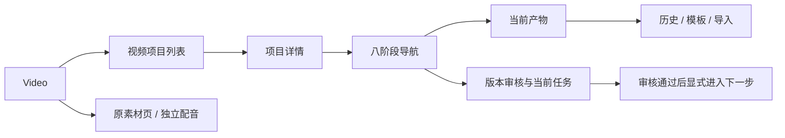

# 视频工作台 · 高保真 UI 与交互基线

初稿：2026-10-22。**2026-10-23 用户明确要求以本文及高保真稿作为生产布局基线**；本功能继续使用现有组件，HeroUI 迁移另行执行。以下保留原提案的业务说明，涉及“尚未批准/待评审”的历史文字不再允许重新设计页面。生产差异及本轮验证见 [布局对齐记录](video-workflow-production-alignment.md)。依据 [规范 2.0](spec-v2.md) 和 [页面规格](page-specs-v2.md)。技术依据见 [完整技术方案](../video-studio-technical-design.zh-CN.md)。

## 1. 阅读与运行

本分支可直接打开 [原稿与生产截图对照页](video-workflow-comparison.html)，无需启动服务。原可交互设计站位于原工作区 `/Users/dorck/self-projects/MyDashboard`，在该目录运行 `pnpm design:preview` 后打开 [分镜工作区](http://127.0.0.1:3046/?page=video&workflow=1&view=project&stage=storyboard&theme=light)。同一设计站顶部“视频工作流提案”也可进入。本功能分支的独立设计站没有接入该提案路由，不要把其普通素材页误认为视频工作流稿。

- [项目列表](http://127.0.0.1:3046/?page=video&workflow=1&view=projects&theme=light)
- [配音审核](http://127.0.0.1:3046/?page=video&workflow=1&view=project&stage=audio&theme=dark)
- [平台发布](http://127.0.0.1:3046/?page=video&workflow=1&view=project&stage=publish&theme=light)
- [依赖失效](http://127.0.0.1:3046/?page=video&workflow=1&view=project&stage=storyboard&scenario=stale)
- [任务失败](http://127.0.0.1:3046/?page=video&workflow=1&view=project&stage=storyboard&scenario=error)
- [执行环境未就绪](http://127.0.0.1:3046/?page=video&workflow=1&view=project&stage=storyboard&scenario=runtime)
- [首次使用](http://127.0.0.1:3046/?page=video&workflow=1&view=projects&scenario=empty)

`stage` 支持 brief / copy / storyboard / narration / audio / roughcut / final / publish。`theme` 支持 light / dark / system。深链初始化前置阶段为已通过，**只用于独立评审某一阶段**，不是跳过生产审核的入口。刷新清除交互状态。

## 2. 已确认需求和本次提案

已确认：≤5 分钟目标、开放题材、一份横版成片、Bilibili / 抖音、本地 CLI + 人工导入、每步人工审核、首期 HyperFrames、导出发布包后人工上传并回填。

布局基线：八个阶段；项目列表与项目详情；详情的预览 + 审核侧栏；“通过 → 下一步 → 生成”分开操作。生产页面合同已同步到页面规格的工作流增量合同。

## 3. 现状证据、布局影响与备选

| 项目 | 当前行为 / 问题证据 | 提案与影响 | 备选 |
| --- | --- | --- | --- |
| Video 入口 | `src/renderer/modules/video/index.tsx` 为封面→音频/演示，素材按类型管理，没有单条视频阶段 | 在 Video 内增加项目工作区；原素材页完整保留，工作区可返回 | 素材页增加项目筛选，改动较小，但审核和顺序难集中 |
| 全局外壳 | 280px 侧栏，左搜索，48px 页内距，桌面密集布局 | 全部沿用；不新增移动导航或改变全局模块顺序 | 无需改动 |
| 单视频详情 | 旧稿主预览、模板动作、审核与任务均以高权重卡片呈现，注意力分散 | 用户要求优化设计后，收敛为主产物 + 240px 审核栏；任务改低权重分隔区域；1024 宽时审核栏224px；较窄时按原提案排列 | 审核全部放底部，预览更宽，但需来回滚动 |
| 阶段导航 | 旧稿八组文字按钮产生横滚，无法同时掌握全部阶段 | 用户明确要求 Stepview：编号节点、连接线、名称和状态分层；完成节点显示勾选，当前节点强调；1024及以上八列，较窄四列两行 | 竖向步骤会继续挤占画布，不采用 |
| 主动作 | 现有素材操作不涉及阶段推进 | 审核放右侧，下一步放底部；保存新版本与影响确认分开 | 合并为“通过并生成下一步”，减少点击但更易误触发 |

对照证据：现有 [Video 浅色稿](video-workflow-reference/video-light.png) 与新增 [分镜提案](video-workflow-reference/video-workflow-storyboard-light.png)。提案不重排原有素材 item；新项目 item 的信息合同独立评审。

历史迭代证据：[优化前](video-workflow-reference/video-workflow-before-stepview.png)、[优化后](video-workflow-reference/video-workflow-storyboard-light.png)。2026-10-23用户已明确要求本功能的生产布局遵循此稿；组件迁移例外见迁移台账，不扩展为其他页面的迁移授权。

## 4. 信息架构与 item 合同

项目列表：页头与新建 → 概况 → 搜索/状态/导入 → 项目行。项目行从左到右为画面缩略图；题材与时长同行→标题→更新时间与平台；最右为阶段状态→继续制作。长标题换行，不改变操作位置。概况为示例固定值，生产由查询汇总，未知不填0。

详情：返回项目列表、项目名与规格；右上环境/历史；阶段导航；就近反馈；当前产物与右侧审核/任务；底部版本提示及下一步。生产按此组织内容，见布局对齐记录。

## 5. 八阶段画面与审核

| 阶段 | 中央内容 | 审核要点 / 操作 |
| --- | --- | --- |
| 创作简报 | 标题、想法、受众、时长、来源 | 审核表达目标；可编辑形成新版本 |
| 内容文案 | 完整文案、大纲与事实提醒 | 内容准确性与结构；未保存编辑禁止审核 |
| HTML 分镜 | 16:9 关键帧、缩略图镜头选择、屏幕文字、口播草稿；右上创作设置 | 按镜查看；模板或 Agent 自由创作；版式逐镜变化；设置保存先确认影响，通过后进入口播 |
| 口播定稿 | 按分镜切换的口播、读音与停顿 | 术语与画面含义一致；语义变化须提示关联画面复审 |
| 分段配音 | 音色/引擎、实际时长、逐段波形与检查标记 | 每段检查齐全后允许通过；单段重做，其他段保留 |
| 动态粗剪 | 预览、进度、分镜与字幕检查提示 | 检查音画、字幕和转场；和静态分镜分开审核 |
| 正式成片 | 成片预览、时长、编码/质量清单 | 对冻结粗剪做正式渲染，完整观看并审核 |
| 平台发布 | 共用成片，平台选择，各自标题/简介/标签/封面，导出及链接 | 每平台资料单独审核；导出不等于发布；分别人工确认链接 |

播放器当前无真实媒体，播放禁用并标注原因；滑块只是交互预览。关键帧为设计示例，不声称为已生成 HyperFrames 工程。实际实现应允许字幕编辑、时间校正和逐段试听，设计稿只展示核心审阅组织，不替代媒体引擎。

## 6. 关键交互合同

### 人工审核

生成/导入完成 → 待审核；审核准确版本 → 下一步按钮可用；点击下一步只打开后续阶段，不自动生成。后续阶段生成成功仍停在待审核。未生成、需修改、依赖失效、有未保存编辑、配音尚未检查齐全均禁止通过。

生成按钮还须校验前置有效审核。阶段导航本身允许查看已有内容，不作为执行权限；生产主进程再次验证。审核和执行分别留事件。

### 修改、模板与返工

提出修改要求具体意见，不覆盖历史；新版本生成后重新审核。保存编辑打开影响弹窗，说明当前版本变化、哪些下游尚未生成、哪些已有结果需要更新。取消不提交修订。模板候选先暂存，确认保存才采用，取消影响确认不改变模板。

生产按 Scene / segment / 资源依赖精确失效；设计稿仅演示阶段级传播。正式实现保存失败保留草稿；未保存离开建议保留项目级草稿并显示状态，是否自动落盘待评审。设计稿保持当前项目正文/逐镜口播草稿，刷新清除；不具备跨项目草稿仓库或自动保存保证。

### 创作设置与多版式

“创作设置”集中管理两种方式：套用视觉模板 / Agent 自由创作。模板展示四种版式示例，而非只展示首页；在同一风格下按 Scene 采用开场大字、流程结构、代码注解、双栏对比。模板切换改变整片或当前镜的视觉语言，不强制覆盖各镜版式。“修改此分镜”可单独选版式和编辑文字，取消不提交。

自由创作提供参考链接（每行一个）、文字描述与 HTML 文件入口，至少填一项；可组合。格式错误就近显示原因，错误时保留输入。支持“整片分镜 / 仅当前分镜”，保存前展示范围与版本影响；关闭或取消放弃此次设置候选，原采用方式与画面保持。已保存要求可重新打开查看。原型仅记录文件名，不读取、执行文件或访问链接；保存后仍展示原有示例画面并需重审，不声称已经生成新画面。生产按技术方案 §10.1，先完成真实候选生成才允许画面审核。

模板模式也只是设计示例：三套风格有不同视觉表达，四个 Scene 采用不同布局；自由创作不受这四种预设限制。上游 Button、Card、Radio 与 Modal 保持 HeroUI 公共外观，页面通过内容网格、减少重复状态胶囊、图标和次要卡片降低拥挤。

### 生成、关闭和失败

任务显示真实阶段，未知进度用 Spinner/indeterminate。显式取消保留已有版本；失败保留输入，可重试当前阶段。关闭弹窗不隐式取消任务。设计稿的1.6秒完成只是模拟延迟，不是性能承诺。生产后台任务须跨页面/应用重启恢复查询；原型只用于当前工作区的交互验证。

### 导入

选择阶段→系统文件选择器→检查→登记待审核。生产检查 schema、版本、引用、路径、hash 和文件可用性；不执行未知 HTML。原型只显示选择的文件名和检查步骤，**不读取或写入产物文件**，不表示校验真的通过。

### 双平台发布

Bilibili / 抖音资料分别审核，导出后显示待人工上传，录入 HTTPS 作品链接后人工确认。URL 仅做语法/域名检查，不能证明平台成功或作品归属。资料变化撤销当前资料审核与导出就绪态；历史真实回执在生产中保持不可变。

设计稿的导出只下载 `design-demo-<platform>-manifest.json`，内有 `designPreview: true`、`videoIncluded: false`，不包含媒体。一个平台完成不改变另一平台。归档为独立操作，原型尚未实现归档按钮业务。

## 7. 组件、主题与键盘

| 组合 | HeroUI 3.2.6 公开组件 | 键盘 / 语义 |
| --- | --- | --- |
| Stepview、分镜导航 | Button + nav/ol/li 业务组合 | Tab/Shift+Tab、Enter/Space；当前阶段 aria-current=step，分镜 aria-pressed；节点编号有完整可访问名称 |
| 字段 / 搜索 | TextField、Label、Input、TextArea、SearchField | 常驻标签、就近 FieldError，文本输入保留；IME 不提交 |
| 平台 / 环境 / 分镜选择 | Select、ListBox | 方向键/Enter；Escape 先关 Select |
| 创作设置 | Modal + RadioGroup / Radio、TextField、系统文件选择 | 方式/模板/范围按方向键选择，Escape 取消；焦点返回创作设置；设置支持整片或单镜 |
| 审核 / 任务 / 状态 | Card、Chip、Alert、Spinner、ProgressBar、Accordion | 文字状态，live region 操作反馈；不只依赖颜色 |
| 新建 / 影响 / 导入 / 历史 | Modal | 焦点约束、Escape、关闭后返回；校验失败不关窗 |
| 进度 | Slider | 有标签和当前数值，方向键调整；禁用播放有原因 |

沿用主题桥，不复制色板，不改上游控件尺寸、圆角或内距。CSS 只负责业务网格、图稿和文字组织。图标使用现有集中映射。HeroUI 组件不代表整页已经通过 WCAG；实际键盘、主题和边界证据见 [验证记录](video-workflow-verification.md)。

## 8. 状态矩阵与待接入边界

| 状态 | 可评审路径 | 生产要求 |
| --- | --- | --- |
| ready / 待审核 / 已通过 | 各阶段直达、通过按钮 | 精确版本审核与持久化 |
| loading / empty / error / offline | 全站 state 评审器；项目 empty；任务 error | 离线不禁用已有本地结果，联网失败只影响当前任务 |
| 未生成 / 前置阻塞 | 通过当前阶段后进入下一阶段；或点后续阶段 | 主进程再次校验，禁止强行提交 |
| running / cancelled / retry | 重新生成、取消、失败场景重试 | 进程组回收、迟到结果和断电恢复 |
| changes / stale / dirty | 修改意见、保存影响、stale 场景 | 依赖指纹与局部影响，不清空历史 |
| runtime missing | runtime 场景与环境弹窗 | 真正检测执行路径/登录/版本，10秒超时 |
| 平台部分完成 | publish 两平台分别操作 | 不伪造平台回执，不把导出视为发布 |
| 缺文件/磁盘满/版本冲突 | 技术方案错误合同，原型未调用真实文件系统 | 正式实现需补实际故障注入验收 |

## 9. 历史评审清单

建议用户先按以下路径体验：分镜换模板并取消→正式保存新版本→通过→口播生成→提出修改→配音逐段检查→发布资料审核、导出示例、分别回填。

已采纳：项目/详情布局、八阶段、审核与下一步分开；本分支沿用现有组件，输出为16:9/1080p30，最长300秒。草稿、归档和素材保护依真实实现规则执行。逐段检查/重做、独立平台审核、提出修改状态等仍需后续业务实现；详见生产布局对齐记录，不将设计站的模拟状态当作真实功能。
